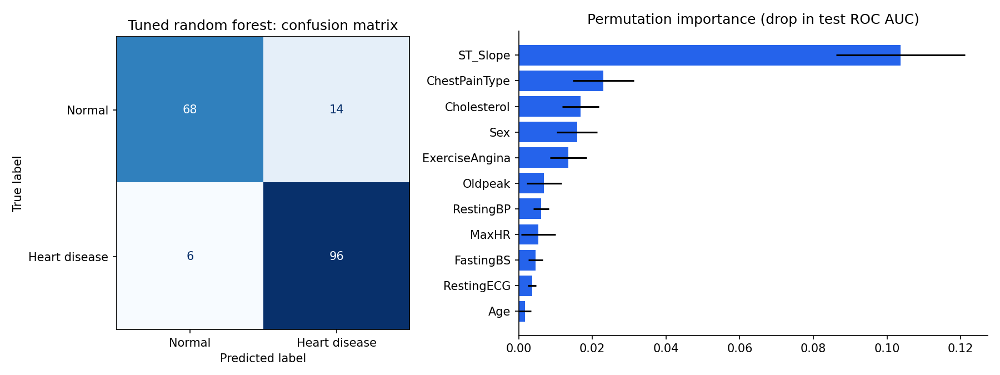
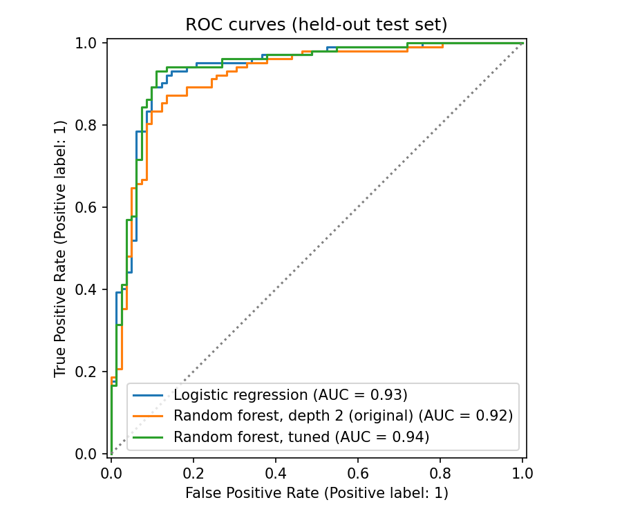
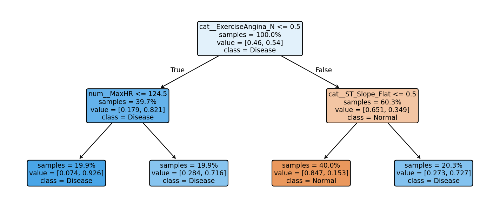

# Heart-disease prediction with random forests

Predicts heart disease from 11 clinical features
([Kaggle heart-failure dataset](https://www.kaggle.com/datasets/fedesoriano/heart-failure-prediction),
918 patients), comparing random forests against a majority-class baseline and logistic
regression, with a proper evaluation protocol.



## Method

* **Data cleaning.** 172 patients (19 %) have `Cholesterol = 0` and one has
  `RestingBP = 0`. Both are physiologically impossible, so they're treated as missing
  values: median-imputed, with a missing-value indicator added.
* **Pipeline.** A scikit-learn `Pipeline` with a `ColumnTransformer` (imputation,
  one-hot encoding of the 5 categorical features, scaling for the linear model), so no
  preprocessing statistic leaks from the test set.
* **Evaluation.** A stratified 80/20 split with a fixed seed. 5-fold stratified
  cross-validation runs on the training set; for the tuned forest it's *nested* (the grid
  search runs inside each fold). Final scores are on the untouched test set. Recall is
  reported alongside accuracy and ROC AUC, because missing a sick patient is the costly
  error.

## Results

| Model | CV ROC AUC | Test accuracy | Test recall | Test ROC AUC |
|---|---|---|---|---|
| Majority class (baseline) | 0.500 | 0.554 | 1.000 | 0.500 |
| Logistic regression | 0.928 ± 0.039 | **0.891** | 0.922 | 0.932 |
| Random forest, depth 2 (original coursework setting) | 0.919 ± 0.034 | 0.848 | 0.892 | 0.915 |
| **Random forest, tuned** (`max_depth=8, min_samples_leaf=5`) | **0.932 ± 0.029** | **0.891** | **0.941** | **0.936** |

* The tuned forest is the best model, catching 96 of 102 sick patients in the test set.
  However, **logistic regression is within noise of it** (CV AUC 0.928 vs 0.932, ± 0.03),
  and it's simpler and interpretable. On this data, the simpler model is a defensible
  choice.
* **ST slope, chest-pain type, cholesterol, sex and exercise angina** drive the
  predictions (permutation importance on the test set).
* **Watch out for cholesterol.** 88 % of patients with *missing* cholesterol have heart
  disease, vs 48 % of the others. Much of the feature's importance comes from the
  missing-value flag: most likely a data-collection artifact (the dataset merges five
  hospitals' records) rather than physiology. A model deployed elsewhere shouldn't rely on
  it.

| ROC curves | One tree of the depth-2 forest |
|---|---|
|  |  |

## Run

```bash
pip install -r requirements.txt
python train.py        # ~1 min; writes docs/*.png and docs/results.md
```

## History

This started as a course project (UQAR); the original French report and slides are in
[`report/`](report/). The code was rewritten so that it:

* runs on current scikit-learn (`max_features='auto'` was removed in 1.3);
* gives reproducible results (the split had no seed);
* treats the zero placeholders as missing values, which was undocumented in the original;
* compares against baselines with cross-validation instead of a single accuracy number;
* draws trees with `sklearn.tree.plot_tree` (no Graphviz install needed).
